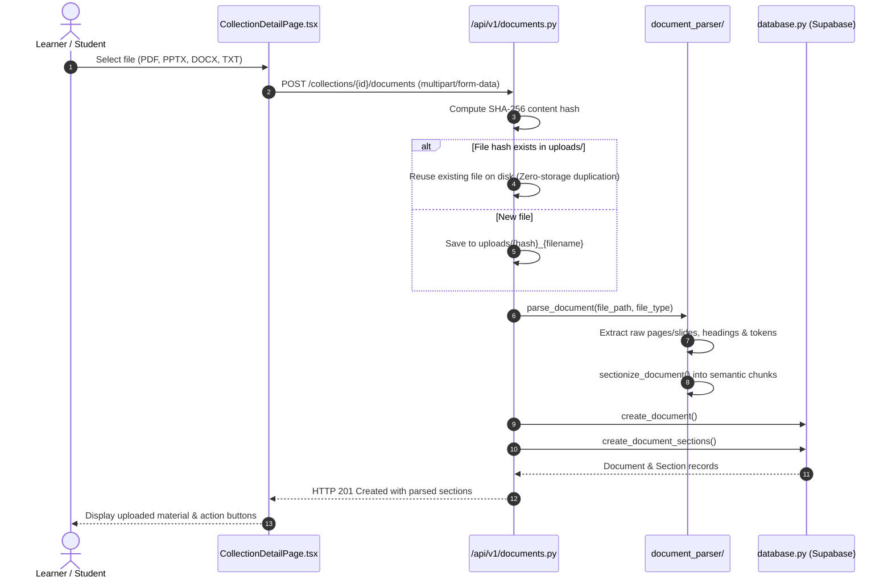
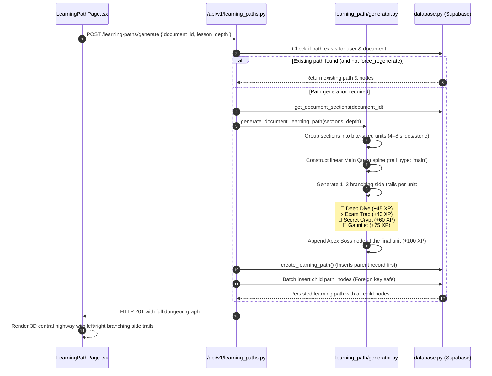

# System Architecture & Engineering Map — Recall

> **The 1-Year Maintainability Standard:**  
> This document is the single authoritative architectural blueprint for Recall. If an engineer opens this repository after 12 months without touching it, this document provides the exact mental model, data flow diagrams, and a complete directory lookup index to locate and modify any feature in under five minutes.

---

## 1. System Philosophy & Mental Model

Recall is an **Active Recall & Syllabus Mastery Platform**. Rather than acting as a passive chatbot or an open-ended conversational wrapper, Recall enforces a structured, curriculum-grounded learning loop inspired by game design and cognitive science:

```
[ Raw Learning Material ] (PDF, DOCX, PPTX, TXT)
            │
            ▼
[ Document Ingestion Pipeline ] ──► Extracts text, retains slide/page indices, headings, structural sections
            │
            ▼
[ Branching Quest Generator ] ──► Synthesizes a Minecraft Dungeons-style curriculum:
                                  • Linear Main Quest highway (Core syllabus)
                                  • Branching side trails (Deep Dives, Exam Traps, Secret Crypts, Gauntlets)
                                  • Apex Boss milestone at the end
            │
            ▼
[ 4-Step Stepping Stone Runner ] ──► Bite-sized study flow for each node:
                                     1. Flip Cards (Prerequisite definitions)
                                     2. Slide Breakdown (Confidence markers & TTS)
                                     3. Companion Q&A (Grounded doubt resolution)
                                     4. Balanced Practice Quiz & Cheat Sheet Export
            │
            ▼
[ Server-Side Evaluation & XP ] ──► Answers verified server-side; XP, streaks, and companion unlocks awarded
```

### Architectural Principles
1. **Separation of Concerns:** The React SPA frontend, FastAPI backend service, Supabase PostgreSQL database, and AI provider integrations are strictly decoupled.
2. **Deterministic Evaluation:** Question answers are never delivered to the client during active quiz or quest runs. All scoring occurs server-side via `services/grading/scorer.py`.
3. **Provider-Agnostic AI Layer:** General business logic never calls external AI SDKs directly. All calls route through `BaseAIProvider` with fallback to offline mock generation.
4. **Resilient Persistence:** Works out-of-the-box locally with memory/disk caching, while seamlessly persisting to Supabase PostgreSQL in production.

---

## 2. "Where Do I Find What?" Quick Lookup Table

Use this table to instantly navigate to the exact source files responsible for any feature or bug fix:

| Feature / Domain | Frontend Location | Backend Route / Schema | Backend Service | Database Table |
| :--- | :--- | :--- | :--- | :--- |
| **Document Upload & Parsing** | `pages/CollectionDetailPage.tsx` | `POST /api/v1/collections/{id}/documents`<br>`schemas/document.py` | `services/document_parser/` | `documents`<br>`document_sections` |
| **Document Reader & Highlighters** | `pages/DocumentPreviewPage.tsx` | `GET /api/v1/documents/{id}`<br>`GET /api/v1/documents/{id}/file` | `services/document_parser/` | `documents` |
| **Dungeon Branching Learning Path** | `pages/LearningPathPage.tsx`<br>`components/learning_path/` | `POST /api/v1/learning-paths/generate`<br>`schemas/learning_path.py` | `services/learning_path/generator.py` | `learning_paths`<br>`path_nodes` |
| **4-Step Stepping Stone Runner** | `components/learning_path/SteppingStoneRunner.tsx` | `POST /api/v1/learning-paths/{id}/nodes/{node_id}/complete` | `services/learning_path/` | `path_nodes` |
| **Study Companions & Pets** | `components/learning_path/PetAssistantChat.tsx`<br>`pages/CompanionsPage.tsx` | `POST /api/v1/learning-paths/chat-assistant`<br>`schemas/pet_assistant.py` | `services/ai/pet_personas.py` | `users` |
| **Quiz Generation & Balancing** | `pages/QuizSetupPage.tsx` | `POST /api/v1/quizzes/generate`<br>`schemas/quiz.py` | `services/quiz_engine/generator.py`<br>`services/quiz_engine/validator.py` | `quizzes`<br>`questions` |
| **Quiz Session & Real-Time Test** | `pages/QuizSessionPage.tsx` | `GET /api/v1/quizzes/{id}` | `services/quiz_engine/` | `quizzes`<br>`questions` |
| **Quiz Scoring & Attempt History** | `pages/QuizResultPage.tsx`<br>`pages/QuizHistoryPage.tsx` | `POST /api/v1/attempts/submit`<br>`schemas/attempt.py` | `services/grading/scorer.py` | `quiz_attempts`<br>`question_responses` |
| **Flashcard Decks & SM-2 Spaced Recall** | `pages/FlashcardsPage.tsx` | `POST /api/v1/flashcards/generate`<br>`schemas/flashcard.py` | `services/cards/generator.py` | `flashcard_decks`<br>`flashcards` |
| **Study Collections & Workspaces** | `pages/DashboardPage.tsx`<br>`pages/CollectionDetailPage.tsx` | `api/v1/collections.py`<br>`schemas/collection.py` | `core/database.py` | `collections` |
| **XP Economy, Streaks & Quests** | `services/xp.ts`<br>`services/quests.ts` | `core/database.py` | `services/xp.ts` (client)<br>`core/database.py` (server) | `users` |
| **Daily To-Do Task Queue** | `pages/TodoListPage.tsx`<br>`services/todos.ts` | Local storage service | `services/todos.ts` | Client state |
| **Weekly League & Social Leaderboard** | `pages/LeaderboardPage.tsx` | `GET /api/v1/friends/leaderboard`<br>`POST /api/v1/friends/request` | `api/v1/friends.py` | `friend_requests`<br>`friendships`<br>`users` |
| **Backpack Inventory & Streak Freezes**| `pages/InventoryPage.tsx`<br>`pages/ShopPage.tsx` | Client service | `services/xp.ts` | Client state |
| **Just Start Mode (ADHD 5-Min Sprint)** | `pages/JustStartPage.tsx` | Standalone UI | Web Audio API / Timer | Client state |
| **Founder Triage & Diagnostics Hub** | `pages/AdminFeedbackPage.tsx` | `GET /api/v1/feedback/`<br>`GET /api/v1/telemetry/logs` | `api/v1/feedback.py`<br>`api/v1/telemetry.py` | `feedback`<br>`telemetry_logs` |
| **Authentication & Founder Access** | `components/auth/AuthModal.tsx`<br>`pages/LoginPage.tsx` | `POST /api/v1/auth/signup`<br>`POST /api/v1/auth/login`<br>`POST /api/v1/auth/google` | `core/security.py` | `users` |
| **Database Persistence & Queries** | `services/api.ts` | `core/database.py` | `supabase-py` client | Supabase PostgreSQL |

---

## 3. High-Level Architecture Diagram

```
+───────────────────────────────────────────────────────────────────────────+
│                               FRONTEND SPA                                │
│                     React 18 + TypeScript + Vite                          │
│                                                                           │
│   [ Pages ] ──► LearningPath │ CollectionDetail │ QuizSession │ Dashboard │
│   [ Stores ] ──► XP Service │ Quest Service │ Audio │ UI Scaling Engine   │
+───────────────────────┬───────────────────────────────────────────────────+
                        │ HTTP / JSON (Bearer JWT / X-User-Id)
                        ▼
+───────────────────────────────────────────────────────────────────────────+
│                              FASTAPI BACKEND                              │
│                                                                           │
│   [ Security & Routing ] ─────────────────────────────────────────────    │
│   • Auth Guard & Guest Session Resolver (`core/security.py`)              │
│   • API v1 Route Controllers (`api/v1/`)                                  │
│                                                                           │
│   [ Core Domain Engines ] ────────────────────────────────────────────    │
│   • Document Parser Engine (`services/document_parser/`)                  │
│       - PyMuPDF (PDF), python-docx (DOCX), python-pptx (PPTX)             │
│       - Smart Sectionizer & Token Estimator                               │
│       - SHA-256 Storage Deduplication (`api/v1/documents.py`)             │
│   • Branching Dungeon Map Generator (`services/learning_path/`)          │
│       - Main Quest spine + 4 Biome side trails + Apex Boss                │
│   • Anti-Bias Quiz Engine (`services/quiz_engine/`)                       │
│       - Option Length Balancing & Distractor Validator                    │
│   • Deterministic Grading Scorer (`services/grading/`)                    │
│                                                                           │
│   [ Persistence Layer ] ──────────────────────────────────────────────    │
│   • Unified Repository (`core/database.py`)                               │
│       - Supabase PostgreSQL (Production persistence)                      │
│       - In-Memory SQLite/JSON Store (Isolated automated tests & dev)      │
│       - Auto-Healing Cold Start Collection Recovery                       │
+───────────────────────┬───────────────────────────────────────────────────+
                        │
                        ├──────────────────────────┐
                        ▼                          ▼
+───────────────────────────────────+   +───────────────────────────────────+
│          SUPABASE CLOUD           │   │         AI PROVIDER LAYER         │
│  • Managed PostgreSQL (12 Tables) │   │  • Primary: Gemini 3.5 Flash Lite │
│  • Row Level Security (RLS)       │   │    (500 requests/day, 15 RPM)     │
│  • Production Database Migrations │   │  • Fallback: Groq LLaMA 3.3 70B   │
│    (`docs/supabase_schema.sql`)   │   │    (14,400 requests/day)          │
│                                   │   │  • Offline Mock AI Provider       │
+───────────────────────────────────+   +───────────────────────────────────+
```

---

## 4. End-to-End Core Domain Lifecycles

### Flow 1: Document Upload & Sectionization


### Flow 2: Branching Dungeon Quest Generation


### Flow 3: 4-Step Stepping Stone Study Runner
Every stepping stone (Main Quest or side trail) opens [`SteppingStoneRunner.tsx`](file:///n:/QuizApp/frontend/src/components/learning_path/SteppingStoneRunner.tsx):
```
[ STEP 1: Flip Cards ]
  • Front/Back concept cards derived from unit slides
  • Mastery toggle to flip and review prerequisite terminology
         │
         ▼
[ STEP 2: Slide Breakdown & Confidence Rating ]
  • Slide-by-slide granular breakdown
  • Text-to-Speech (Web Speech API) audio reader
  • Confidence marker (Low / Medium / Mastered)
         │
         ▼
[ STEP 3: Companion Queries ]
  • Active companion (Sydney, Connie, Milo, Scooby, Bunny)
  • In-lesson doubts answered grounded strictly in slide context
         │
         ▼
[ STEP 4: Targeted Quiz & Cheat Sheet ]
  • 2–4 targeted evaluation questions
  • Option length balanced to eliminate giveaway bias
  • 1-Click Markdown Cheat Sheet export
         │
         ▼
[ Completion & XP Unlock ]
  • Scores submitted to server; next main node unlocks; +25 to +100 XP awarded
```

### Flow 4: Anti-Bias Quiz Engine & Server-Side Scoring
1. **Length-Balancing Engine ([`validator.py`](file:///n:/QuizApp/backend/app/services/quiz_engine/validator.py)):**  
   Language models naturally write the correct answer significantly longer than incorrect distractors. Recall measures the character length ratio of options and rejects or trims choices where the correct answer exceeds the average distractor length by more than 25%.
2. **Deterministic Evaluation ([`scorer.py`](file:///n:/QuizApp/backend/app/services/grading/scorer.py)):**  
   The quiz endpoint strips `correct_answers` from payloads sent to the client. Upon submission, the server computes the score, registers the attempt in `quiz_attempts`, logs each choice in `question_responses`, and records XP.

---

## 5. Backend Code Architecture

All backend code resides in `backend/app/`:

```
backend/app/
├── main.py                     # FastAPI application factory, CORS, exception handlers
├── api/                        # HTTP API controllers (Routing layer)
│   └── v1/
│       ├── attempts.py         # Quiz submission & historical score retrieval
│       ├── auth.py             # User signup, password verification, Google OAuth, Founder claim
│       ├── collections.py      # Study collection CRUD & cold-start auto-recovery
│       ├── documents.py        # File ingestion, SHA-256 deduplication, preview
│       ├── feedback.py         # Playtester bug reporting & triage inbox
│       ├── flashcards.py       # Flashcard deck generation & SM-2 review
│       ├── friends.py          # Social leaderboard, friend invites, XP high-fives
│       ├── learning_paths.py   # Dungeon path generation, node completion, companion chat
│       ├── quizzes.py          # Exam quiz generation (STRICT & CONCEPTUAL modes)
│       ├── router.py           # Master v1 router aggregator
│       └── telemetry.py        # Client telemetry logging & performance analytics
├── core/                       # Cross-cutting foundational modules
│   ├── config.py               # Pydantic BaseSettings, environment variables, multi-env loading
│   ├── database.py             # Unified Repository (Supabase client, in-memory test store)
│   ├── errors.py               # Custom domain exceptions & HTTP error helpers
│   └── security.py             # JWT token generation, password salting, admin guards
├── schemas/                    # Pydantic v2 data transfer schemas
│   ├── attempt.py              # Attempt submission and result models
│   ├── collection.py           # Collection creation and response models
│   ├── document.py             # Document and section models
│   ├── flashcard.py            # Flashcard deck and card models
│   ├── learning_path.py        # PathNode, TrailType, and LearningPath models
│   ├── pet_assistant.py        # Companion chat request/response models
│   └── quiz.py                 # Quiz, Question, and QuestionPublic models
└── services/                   # Pure domain business logic (Framework-independent)
    ├── ai/                     # LLM provider integrations
    │   ├── base.py             # BaseAIProvider abstract interface
    │   ├── factory.py          # Provider factory (Gemini, Groq, Mock)
    │   ├── gemini.py           # Gemini 3.5 Flash Lite provider (500 RPD, 429 failover)
    │   ├── groq.py             # Groq LLaMA 3.3 70B provider (14,400 RPD)
    │   ├── mock_provider.py    # Zero-credential offline test generator
    │   └── pet_personas.py     # Companion dialogue prompts (Sydney, Connie, Milo, etc.)
    ├── cards/                  # Flashcard synthesis
    ├── document_parser/        # Extraction engines (PDF, DOCX, PPTX, TXT) & sectionizer
    ├── grading/                # Scorer & attempt grade evaluation
    ├── learning_path/          # Branching dungeon trail generator
    └── quiz_engine/            # Question generation & option length balancing
```

---

## 6. Frontend Code Architecture

All frontend code resides in `frontend/src/`:

```
frontend/src/
├── main.tsx                    # Application entrypoint & DOM mounting
├── App.tsx                     # Root router configuration (React Router v6)
├── pages/                      # Top-level screen views (16 pages)
│   ├── DashboardPage.tsx       # Study collections grid, to-do checklist, quick start
│   ├── CollectionDetailPage.tsx# Material workspace, document uploads, launch shortcuts
│   ├── LearningPathPage.tsx    # Minecraft Dungeons branching quest map
│   ├── DocumentPreviewPage.tsx # Multi-color highlighter reader & text preview
│   ├── QuizSetupPage.tsx       # Exam parameter setup (mode, difficulty, count)
│   ├── QuizSessionPage.tsx     # Active distraction-free quiz runner
│   ├── QuizResultPage.tsx      # Grade report, question reviews, score breakdown
│   ├── QuizHistoryPage.tsx     # Historical attempt analytics & retry mistakes
│   ├── FlashcardsPage.tsx      # SM-2 flip cards & slide-by-slide decks
│   ├── CompanionsPage.tsx      # Companion squad showcase & cheerleader selection
│   ├── ShopPage.tsx            # Spendable XP shop (Streak Freezes, Boosters)
│   ├── InventoryPage.tsx       # Backpack inventory & held power-up management
│   ├── LeaderboardPage.tsx     # Weekly Gold League, friend rankings, high-fives
│   ├── TodoListPage.tsx        # Daily micro-task study action planner
│   ├── JustStartPage.tsx       # ADHD 5-minute micro-sprint with ambient audio
│   ├── LoginPage.tsx           # Email/password & Google login
│   └── AdminFeedbackPage.tsx   # Restricted Founder Bug Inbox & Diagnostics Hub
├── components/                 # Reusable UI widgets
│   ├── auth/                   # AuthModal (Signup, Login, Password reset)
│   ├── common/                 # FeedbackModal, QuestDetailModal, TutorialModal
│   ├── layout/                 # AppLayout, Navbar, SidebarNav, RightWidgetSidebar, MobileBottomNav
│   └── learning_path/          # SteppingStoneRunner, PetAssistantChat, SandboxSetupModal
├── services/                   # Frontend data services & local stores
│   ├── api.ts                  # Centralized HTTP client with automatic fetch retry
│   ├── companions.ts           # Companion avatar registry, cheer quotes, unlock milestones
│   ├── quests.ts               # Daily quest tracker & streak milestone logic
│   ├── supabase.ts             # Supabase JS client singleton
│   ├── telemetry.ts            # Client-side analytics & error tracking
│   ├── theme.ts                # Light / Dark mode management
│   ├── todos.ts                # Study checklist state with event dispatcher
│   ├── uiScale.ts              # Responsive display scaling (Compact, Normal, Cozy)
│   └── xp.ts                   # Centralized XP wallet, level calculations, coin balances
├── styles/                     # Design system tokens
│   ├── variables.css           # CSS variables (colors, radii, shadows, typography)
│   └── global.css              # Tactile 3D button classes, badges, layout grids
├── types/                      # TypeScript type contracts
│   └── index.ts                # PathNode, LearningPath, Quiz, UserProfile, etc.
└── utils/                      # Helper utilities
    ├── confetti.ts             # Zero-dependency canvas confetti explosion
    └── sound.ts                # Web Audio sound effects synthesizer (Correct, Victory, Tick)
```

---

## 7. Database Architecture (Supabase PostgreSQL)

Recall uses **PostgreSQL** hosted on Supabase. The complete production schema is defined in [`docs/supabase_schema.sql`](file:///n:/QuizApp/docs/supabase_schema.sql).

### Key Design Decisions
1. **Unconstrained User IDs:** `collections.user_id`, `documents.user_id`, etc. are stored as `TEXT NOT NULL` without hard foreign key references to `public.users(id)`. This allows visitors and guest playtesters (`guest_xxxx`) to create collections and upload files without encountering foreign key errors before creating a registered account.
2. **Cascade Deletes:** Deleting a collection cascades to associated documents, sections, quizzes, and learning paths automatically.
3. **Parent-Before-Child Ingestion:** When creating a learning path, `learning_paths` is persisted before `path_nodes` to satisfy PostgreSQL foreign keys.
4. **Auto-Healing Cold Start Recovery:** If a free-tier cloud container restarts and loses ephemeral cache, `get_or_restore_collection` in `database.py` recreates the collection record on-the-fly, preventing 404 upload errors.

---

## 8. Clean Code Standards ("No AI Slop")

To keep the repository clean and maintainable by humans:

1. **No Redundant Comments:** Avoid commenting on what code obviously does.
   * *Bad:* `// set loading to false` ➔ `setLoading(false);`
   * *Good:* Explain the non-obvious *why*, or use structural section dividers:
     ```typescript
     // --- RUNTIME STATE ---
     // --- ACTION HANDLERS ---
     // --- RENDER HELPERS ---
     ```
2. **Product-First Terminology:** Avoid AI branding clichés in user interfaces.
   * *Bad:* "AI-Powered Generation", "AI Pet Assistant", "Magic AI Summary"
   * *Good:* "Curriculum Generator", "Study Companion", "Key Concept Review"
3. **Strict Typing:** Avoid `any` in TypeScript. All API payloads must have an explicit interface in `types/index.ts`. All FastAPI endpoints must declare `response_model=...`.
4. **Single-Responsibility Files:** Files should not exceed 400 lines where practical. Large view components should extract inner sub-components into dedicated files under `components/`.
5. **No Broken Tests:** Every backend service has an automated pytest in `backend/tests/`. All 35 tests must pass before any commit is pushed.

---

## 9. Environment & Deployment Reference

### Deployment Matrix
| Component | Hosting Platform | Build Command | Live URL |
| :--- | :--- | :--- | :--- |
| **Frontend** | Vercel | `npm run build` | `https://quiz-app-dusky-nine-68.vercel.app` |
| **Backend** | Render (Free Tier) | `pip install -r requirements.txt` | `https://quizapp-backend-ry1b.onrender.com/api/v1` |
| **Database** | Supabase | Execute `docs/supabase_schema.sql` | `https://dbouqbtuxbeskbsjykyi.supabase.co` |

### Required Environment Variables
#### Backend (`backend/.env` & Render Dashboard):
```env
PORT=8000
ENVIRONMENT=production
CORS_ORIGINS=http://localhost:5173,https://quiz-app-dusky-nine-68.vercel.app

# Supabase PostgreSQL
SUPABASE_URL=https://<project-ref>.supabase.co
SUPABASE_KEY=<service-role-secret-key>

# AI Provider Configuration
AI_PROVIDER=gemini
GEMINI_API_KEY=<google-ai-studio-key>
GROQ_API_KEY=<optional-groq-key>

MAX_UPLOAD_SIZE_MB=25
FOUNDER_PASSCODE=recall-founder-2026
ADMIN_EMAILS=harshit27saini@gmail.com
```

#### Frontend (`frontend/.env` & Vercel Dashboard):
```env
VITE_API_BASE_URL=https://quizapp-backend-ry1b.onrender.com/api/v1
VITE_SUPABASE_URL=https://<project-ref>.supabase.co
VITE_SUPABASE_ANON_KEY=<supabase-anon-public-key>
```
